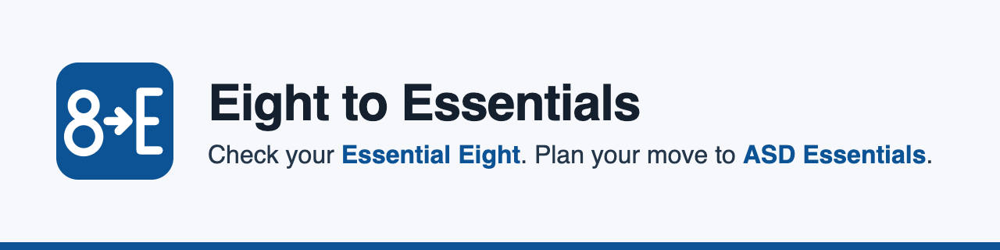
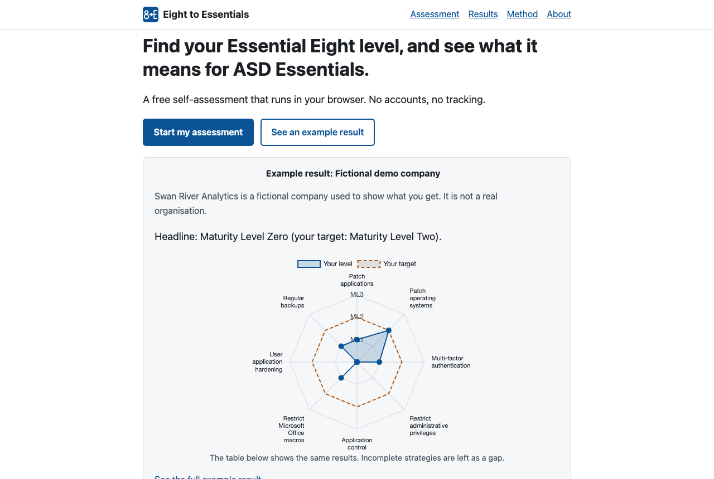
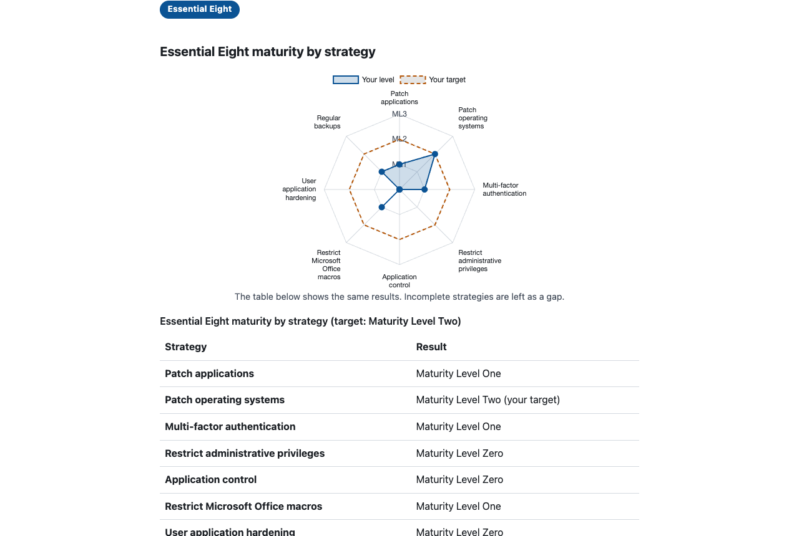
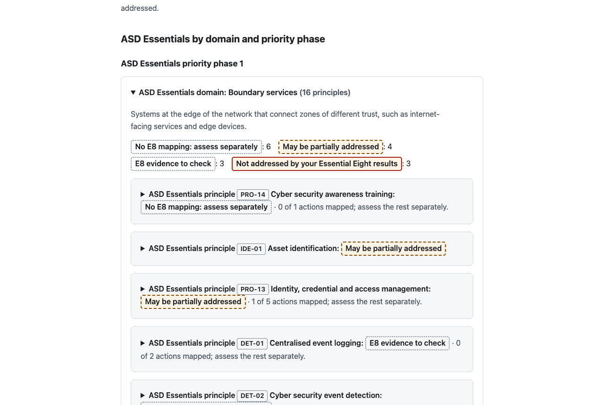

<p align="center">
  
</p>

# Eight to Essentials

_Check your Essential Eight. Plan your move to ASD Essentials._

**[Try the live demo](https://AzwadBhuiyan.github.io/eight-to-essentials/)** · [Method and sources](docs/methodology.md) · [Security](SECURITY.md)

[](https://github.com/AzwadBhuiyan/eight-to-essentials/actions/workflows/ci.yml)
[](https://github.com/AzwadBhuiyan/eight-to-essentials/actions/workflows/codeql.yml)
[](LICENSE)

Built by **[Azwad Bhuiyan](https://www.linkedin.com/in/azwad-bhuiyan)**, Master of Computing (Cyber Security) student, Curtin University, Perth.

> Self-assessment. Not an official ASD assessment, audit or certification. Not legal, compliance or insurance advice. Not affiliated with or endorsed by ASD or the ACSC.

## Screenshots

All screenshots show **Swan River Analytics, a fictional demo company**.

| Home                                                       | Essential Eight results                                                                                          | ASD Essentials transition view                                                                                           |
| ---------------------------------------------------------- | ---------------------------------------------------------------------------------------------------------------- | ------------------------------------------------------------------------------------------------------------------------ |
| [](docs/images/home.png) | [](docs/images/results.png) | [](docs/images/transition.png) |

## Why it exists

On 15 October 2026 the Australian Signals Directorate (ASD) published **ASD Essentials**, the evolution of the Essential Eight. It replaces maturity levels with principles, actions, domains and priority phases.

During the transition, many organisations still need to show Essential Eight progress to customers, insurers or government buyers, while also planning for what comes next. Eight to Essentials was built in the weeks after the launch to help with both questions:

- Where do we stand on the Essential Eight today?
- Where might that work carry into ASD Essentials, what is new, and where does ASD suggest starting?

## Features

- **Essential Eight self-check** across all eight strategies, Maturity Levels One to Three, against a target level you choose. One question per requirement, each with its ISM control ID, plain-English wording, why it matters and what evidence would show it.
- **Results**: a level per strategy, a headline set by the weakest strategy, a radar chart with a table alternative, a prioritised action list, an evidence request list and exceptions to review.
- **ASD Essentials transition view**: an indicative gap analysis at action and domain level, built on ASD's own mapping tables, grouped by priority phase, plus the actions the Essential Eight does not cover.
- **Printable report** that saves cleanly to PDF from the browser.
- **Export and import** answers as JSON; **export results** as CSV.
- **Demo mode** with a fictional company, so you can see a full result without answering any questions.
- Works on phones, in light and dark mode, and with a keyboard.

## How it works

1. **Context**: three short questions, including whether you still need to report Essential Eight maturity and where your systems mainly run.
2. **Essential Eight questions**: a strategy is at Maturity Level L only when every requirement at levels 1 to L is met. "Partly" and "Not sure" never count as met. "Does not apply" and exceptions need a written reason (and, for exceptions, a compensating control, approver and review date) and are listed for review.
3. **Results**: unmet requirements are ordered by level, then exposure (internet-facing and identity first), then effort. If you no longer need to report Essential Eight maturity, the list is framed as risk-reduction actions, following ASD's advice not to start work only to reach a superseded target.
4. **Transition view**: for each mapped ASD Essentials action and domain, ASD's tables give the Essential Eight level that contributes and whether the contribution is full or partial. The app compares that with your result. It **never converts** Essential Eight levels into ASD Essentials effectiveness ratings.

All scoring is fixed, transparent rules in [`src/lib/`](src/lib/), covered by unit tests. The full rules and every design decision are in [docs/methodology.md](docs/methodology.md).

## Demo company

**Swan River Analytics is fictional.** It is a made-up Perth SaaS company of about 85 staff, used only to show what a mixed, realistic result looks like. Any resemblance to a real organisation is unintended. Opening the demo never changes your own answers.

## Privacy and security

- **Your answers never leave your browser.** There is no backend, no account, no analytics, no tracking, no cookies and no ads.
- **No AI and no API keys.** The app never calls an AI model or any other service; the only files it loads are its own.
- Saving progress in your browser is opt-in, with a "Clear my data" button.
- A strict Content Security Policy allows only the site itself, with no inline scripts and no third-party origins. All libraries are bundled.
- Imported files are validated strictly (unknown fields, wrong types and files over 1 MB are rejected). CSV exports are protected against spreadsheet formula injection.
- In the repository: CodeQL analysis, Dependabot for npm and GitHub Actions, workflows pinned to full commit SHAs with minimum permissions, locked dependency versions and a pinned Node version. See [SECURITY.md](SECURITY.md) to report a vulnerability.

## Tech stack

Vite, React and TypeScript (static site, no backend) · Chart.js with react-chartjs-2 · Zod · Vitest, React Testing Library and axe-core · ESLint and Prettier · GitHub Actions and GitHub Pages.

## Run locally

Requires Node.js 24 (see [`.nvmrc`](.nvmrc)).

```sh
npm ci
npm run dev            # start the development server
npm test               # run the unit tests
npm run validate-data  # check the framework data files
npm run lint           # lint
npm run build          # build the static site into dist/
```

## Sources, versions and data checked date

| Framework or document                                      | Version       | Link                                                                                             |
| ---------------------------------------------------------- | ------------- | ------------------------------------------------------------------------------------------------ |
| Essential Eight maturity model                             | November 2023 | [cyber.gov.au](https://www.cyber.gov.au/publication/essential-eight-maturity-model)              |
| ASD Essentials for enterprise IT (and Assessment Workbook) | October 2026  | [cyber.gov.au](https://www.cyber.gov.au/publication/essentials-for-enterprise-it)                |
| Transitioning from the Essential Eight                     | October 2026  | [cyber.gov.au](https://www.cyber.gov.au/publication/transitioning-from-the-essential-eight)      |
| Assessment process guide                                   | October 2026  | [cyber.gov.au](https://www.cyber.gov.au/publication/assessment-process-guide)                    |
| Assessment evidence guide for enterprise IT                | October 2026  | [cyber.gov.au](https://www.cyber.gov.au/publication/assessment-evidence-guide-for-enterprise-it) |
| ASD Essentials overview: Frequently asked questions        | October 2026  | [cyber.gov.au](https://www.cyber.gov.au/publication/frequently-asked-questions)                  |

**Data checked on 20 October 2026.** Every requirement, principle, action and mapping row in [`src/data/`](src/data/) records its source. Details are in [docs/data-sources.md](docs/data-sources.md).

## Limitations

- **Self-assessment.** Answers are not verified, and people tend to rate themselves generously.
- **No evidence checking.** The app lists the evidence that would support an answer; it cannot inspect it.
- **Paraphrased requirements.** Plain English loses some nuance. The official wording always takes precedence.
- **My own rules on top of ASD's.** The transition roll-up (the weakest mapped action sets the principle), the exposure and effort tags used to order the action list, and product groups for "Does not apply" are my own heuristics, labelled as such in the app and in [docs/methodology.md](docs/methodology.md).
- **Enterprise IT chapter only.** The ASD Essentials cloud and operational technology chapters are not covered.
- **Written mainly for larger organisations.** ASD says the Essentials series is aimed mainly at Commonwealth entities, critical infrastructure and large organisations. Small businesses should also look at ASD's small business guidance on [cyber.gov.au](https://www.cyber.gov.au).

## Disclaimer

Eight to Essentials is an educational self-assessment and planning aid. It is not an official ASD assessment, audit or certification, it does not show compliance with anything, and it is not legal, compliance or insurance advice. Results are indicative. It is not affiliated with or endorsed by the Australian Signals Directorate (ASD) or the Australian Cyber Security Centre (ACSC).

## Attribution

The app summarises and paraphrases material published by ASD on [cyber.gov.au](https://www.cyber.gov.au), including the [Essential Eight maturity model](https://www.cyber.gov.au/publication/essential-eight-maturity-model) and the [ASD Essentials](https://www.cyber.gov.au/publication/essentials-for-enterprise-it) series. That material is © Commonwealth of Australia and is used under the [Creative Commons Attribution 4.0 International licence](https://creativecommons.org/licenses/by/4.0/). It is not relicensed under MIT. The Commonwealth Coat of Arms and the ASD logo are not used in this project.

## What I learned

> **To be written by Azwad.** This section is intentionally left for the author to write in their own words.

## Roadmap

- **v1.1:** an ASD Essentials priority phase 1 check (Governance and culture, Visibility and response, Boundary services and Identity services), rating actions per domain as ASD's Assessment process guide describes.
- **Later:** the ASD Essentials cloud chapter, and keeping the data current as ASD updates the series.

See [CHANGELOG.md](CHANGELOG.md) for released versions.

## Author and licence

Created by **Azwad Bhuiyan**, Master of Computing (Cyber Security) student at Curtin University, Perth, Western Australia.

- LinkedIn: [linkedin.com/in/azwad-bhuiyan](https://www.linkedin.com/in/azwad-bhuiyan)
- GitHub: [@AzwadBhuiyan](https://github.com/AzwadBhuiyan)

Source code: [MIT licence](LICENSE), © 2026 Azwad Bhuiyan. ASD content: CC BY 4.0, as described under [Attribution](#attribution). If you use this project in your work, GitHub's "Cite this repository" button uses [CITATION.cff](CITATION.cff).
